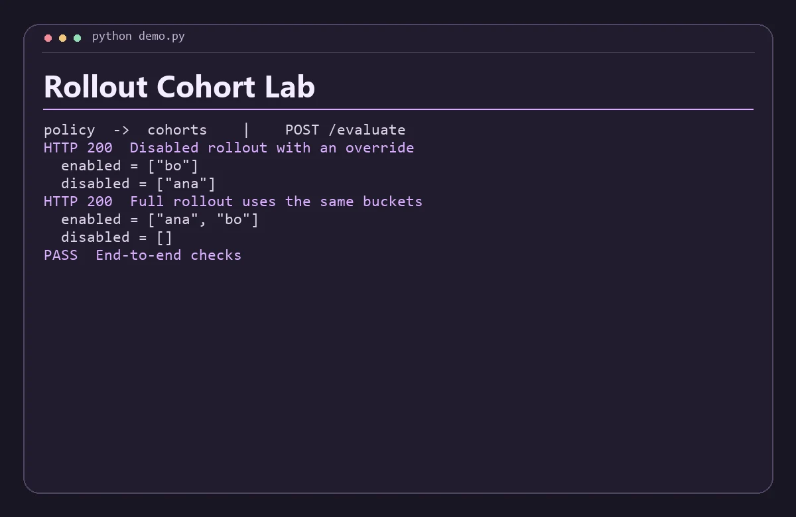

# Rollout Cohort Lab

Try percentage rollouts and explicit overrides with independent policy and deterministic cohort services.



## Run the demo

Install Python 3.11+, Node.js 22+, then run this from the repository root.

```sh
python demo.py
```

The command starts both services on separate loopback ports, sends the requests in `examples.json`, checks the responses, and shuts down the processes. Use `python3` if that is how your system exposes Python.

## Run the services with Docker Compose

```sh
docker compose up -d --build
python demo.py --base-url http://127.0.0.1:8080
docker compose down
```

The API binds to loopback on port 8080 by default. Set `DEMO_PORT` and use the matching base URL to run another project alongside it. Set-up and service discovery follow the [Docker Compose networking documentation](https://docs.docker.com/compose/how-tos/networking/).

Both services are stateless and work with the data in each request. Start from fresh demo state before rerunning the scripted Compose checks.

## Architecture

Cohorts hashes each flag/subject pair with SHA-256 into one of 10,000 buckets. Policy combines those stable buckets with the caller's rollout percentage and explicit subject overrides.

| Service | Runtime | Operation |
| --- | --- | --- |
| `policy` | JavaScript | Public demo API, `POST /evaluate` |
| `cohorts` | Python | Internal service, `POST /bucket` |

The two services exchange JSON over HTTP. Each has a `GET /health` endpoint for process readiness. Compose starts the API after the internal service passes its readiness probe. A gateway request returns HTTP 502 when its dependency is unavailable or fails unexpectedly. Invalid input returns HTTP 400. Domain conflicts return HTTP 409 where supported.

## API example

Send flag, percent (0–100, interpreted to hundredths), subjects and an optional overrides object mapping subject IDs to booleans. Subject IDs in this demo are fictional.

From a running Compose stack, save this JSON as `input.json` and run the command below. On Windows use `curl.exe` if your shell aliases `curl`.

```json
{
  "flag": "new-search",
  "percent": 0,
  "subjects": [
    "ana",
    "bo"
  ],
  "overrides": {
    "bo": true
  }
}
```

```sh
curl -s -H "Content-Type: application/json" --data-binary @input.json http://127.0.0.1:8080/evaluate
```

The response includes these fields.

```json
{
  "enabled": [
    "bo"
  ],
  "disabled": [
    "ana"
  ]
}
```

## Scope

This is a local portfolio project using synthetic data. The APIs are intended for loopback and the private Compose network. A public deployment would need authentication, rate limits, and production observability.
